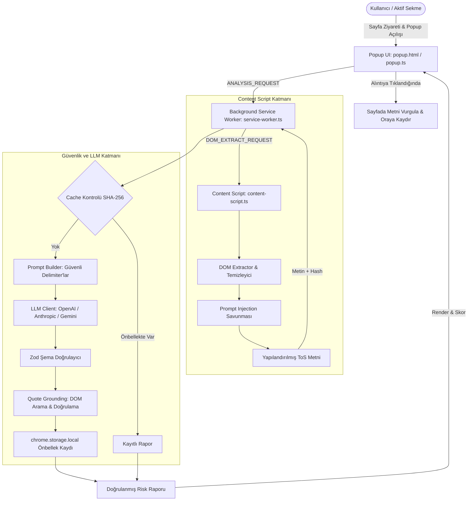

# ToS Risk Analyzer - Kullanım Koşulları & Gizlilik Politikası Risk Analizcisi

> **Chrome Extension (Manifest V3)** | **TypeScript + Vite** | **LLM Tabanlı Yapılandırılmış Risk Analizi** | **Güvenli DOM Çıkarımı & Prompt Injection Savunması**

---

## 📌 İçindekiler
1. [Proje Özeti](#-proje-özeti)
2. [Mimari Tasarım](#-mimari-tasarım)
3. [Temel Yetenekler & Güvenlik Özellikleri](#-temel-yetenekler--güvenlik-özellikleri)
4. [Risk Kategorileri & Puanlama Algoritması](#-risk-kategorileri--puanlama-algoritması)
5. [Kurulum ve Çalıştırma](#-kurulum-ve-çalıştırma)
6. [Chrome'a Eklenti Olarak Yükleme](#-chromea-eklenti-olarak-yükleme)
7. [Analiz Motoru ve LLM Sağlayıcı Yapılandırması](#-analiz-motoru-ve-llm-sağlayıcı-yapılandırması)
8. [Mini Evaluation & Benchmark Suite](#-mini-evaluation--benchmark-suite)
9. [Cypress E2E Testleri](#-cypress-e2e-testleri)
10. [Klasör Yapısı](#-klasör-yapısı)
11. [Hukuki Uyarı & Sorumluluk Reddi](#-hukuki-uyarı--sorumluluk-reddi)

---

## 🎯 Proje Özeti

**ToS Risk Analyzer**, kullanıcılar web sitelerinin Kullanım Koşulları (*Terms of Service*), Gizlilik Politikası (*Privacy Policy*) veya Abonelik Sözleşmesi sayfalarını ziyaret ettiğinde:
1. Sayfa içeriğini dinamik olarak DOM üzerinden ayıklar (görünmeyen/gizlenmiş metinleri ve olası zararlı enjeksiyonları filtreler).
2. Alibaba Page Agent ilkelerine uygun akıllı metin çıkarma ve DOM grounding tekniklerini uygular.
3. **Varsayılan olarak API anahtarı gerektirmeyen yerleşik Yerel Analiz Motoru** ile kural tabanlı risk raporu üretir. İsteğe bağlı olarak harici LLM sağlayıcıları (OpenAI GPT-4o, Anthropic Claude, Google Gemini) ile deterministik (temperature=0.1) ve Zod şemalı yapılandırılmış JSON risk raporu da üretilebilir.
4. Çıkarılan risk maddelerinin web sayfasındaki gerçek sözleşme maddeleriyle birebir örtüştüğünü (DOM Grounding / Quote Verification) doğrular, sayfada ilgili bölümü vurgular.
5. Sonuçları SHA-256 tabanlı yerel önbellekte saklar ve şık bir açılır panel (Popup UI) üzerinde kullanıcıya sunar.

---

## 🏗️ Mimari Tasarım

Aşağıdaki Mermaid diyagramı, eklentinin bileşenleri arasındaki veri akışını ve güvenlik katmanlarını göstermektedir:



---

## 🛡️ Temel Yetenekler & Güvenlik Özellikleri

### 1. Çok Katmanlı Prompt Injection Savunması
- **Görünmez/Gizli Eleman Tespiti**: `display: none`, `visibility: hidden`, `opacity: 0`, `font-size: 0`, ekran dışına taşırılmış (`position: absolute; left: -9999px`) metinler filtrelenir ve izole edilir.
- **Zararlı Talimat Kalıpları**: `Ignore previous instructions`, `Disregard all prior`, `Pretend that you`, `[INST]`, `SYSTEM OVERRIDE`, `<|im_start|>` gibi sistem komutlarını manipüle etmeye yönelik kalıplar Regex tabanlı denetimle yakalanır ve kullanıcı arayüzünde kırmızı uyarı kartı olarak raporlanır.
- **Güvenli Delimiter İzolasyonu**: LLM'e gönderilen kullanıcı sözleşme metni rastgele oluşturulmuş kriptografik XML/Markdown delimiter'ları (`===BEGIN_UNTRUSTED_TOS_DOCUMENT===`) arasına yerleştirilerek modelin girdi metnini talimat olarak yorumlaması engellenir.

### 2. Açıklanabilirlik & DOM Grounding (Halüsinasyon Engelleme)
- LLM'in uydurma madde veya hayali alıntı üretmesini önlemek için her risk maddesi için **`exact_quote` (orijinal metin alıntısı)** ve **`confidence_score` (0.0 - 1.0)** üretilir.
- Çıkarılan alıntı, istemci tarafında sayfadaki gerçek metin bloklarıyla normalize edilerek (büyük/küçük harf, boşluk ve noktalama normalizasyonu) eşleştirilir. Sayfada bulunamayan alıntılar işaretlenir.
- Kullanıcı popup panelindeki risk maddesine veya "Sayfada Göster" butonuna tıkladığında, ilgili sözleşme paragrafı orijinal sayfada animasyonlu sarı arka planla vurgulanır ve ekran oraya kaydırılır (`scrollIntoView`).

### 3. Deterministik Yanıt ve Zod Doğrulaması
- Sıcaklık parametresi varsayılan olarak `temperature = 0.1` olarak sabitlenir.
- LLM yanıtı `zod` kütüphanesi ile çalışma zamanında (runtime) tip denetimine tabi tutulur. Şemaya uymayan hiçbir bozuk JSON verisi arayüze aktarılmaz.

### 4. Akıllı Yerel Önbellekleme (Caching & TTL)
- Analiz edilen sayfa içeriği ve URL'i üzerinden `SHA-256` hash anahtarı üretilir.
- `chrome.storage.local` üzerinde saklanan sonuçlar 7 günlük TTL (*Time-To-Live*) mekanizmasına sahiptir. Aynı sayfada tekrar analiz istendiğinde harici API isteği atılmadan milisaniyeler içinde anında sunulur.

---

## 📊 Risk Kategorileri & Puanlama Algoritması

Risk skoru **0 (Çok Güvenli)** ile **100 (Kritik Riskli)** arasında normalize edilir:

| Kategori | Açıklama | Ağırlık | Örnek Risk Maddeleri |
|---|---|:---:|---|
| **Veri Gizliliği** | Kişisel veri toplama, biyometrik veri, 3. taraflara satış ve takip | Yüksek | Konum takibi, veri simsarlarına satış, 7+ yıl saklama |
| **Otomatik Yenileme & Ödeme** | Otomatik yenilenen abonelikler, gizli ücretler, ceza faizi | Yüksek | 45 gün önceden bildirim şartı, %15 yıllık zam, iade hakkı yok |
| **Fesih & Değişiklik Hakkı** | Hizmet sağlayıcının tek taraflı fesih ve sözleşme değiştirme hakkı | Orta | Bildirimsiz sözleşme değişikliği, sebepsiz hesap dondurma |
| **Yargı Yolu & Tahkim** | Tüketicinin mahkemeye başvurma ve toplu dava hakkını engelleme | Orta | Yabancı ülke tahkimi (Delaware, Singapur), toplu dava feragati |
| **Fikri Mülkiyet & İçerik** | Kullanıcının yüklediği içerikler üzerindeki devir ve kullanım lisansı | Orta | Kullanıcı içeriğinin süresiz, ücretsiz ve telifsiz devri |
| **Diğer / Muğlak İfadeler** | Çelişkili taahhütler, belirsiz sorumluluk reddi ifadeleri | Düşük | "Hizmet verilebilir veya verilmeyebilir" tarzı muğlaklıklar |

### Risk Seviyeleri:
- 🟢 **Düşük Risk (0 - 30)**: Standart, tüketici dostu sözleşmeler.
- 🟡 **Orta Risk (31 - 65)**: Bazı kısıtlayıcı veya dikkat edilmesi gereken maddeler içerir.
- 🔴 **Yüksek Risk (66 - 100)**: Tek taraflı, agresif veri paylaşımı veya tüketici aleyhine ağır şartlar içerir.

---

## 🚀 Kurulum ve Çalıştırma

### Gereksinimler
- **Node.js** (v18.0.0 veya üzeri)
- **npm** (v9.0.0 veya üzeri)

### 1. Bağımlılıkları Yükleme
```bash
npm install
```

### 2. TypeScript Denetimi (Typecheck)
```bash
npm run typecheck
```

### 3. Geliştirme Modunda Çalıştırma (Canlı İzleme)
```bash
npm run dev
```

### 4. Üretim İçin Derleme (Production Build)
```bash
npm run build
```
> Bu komut `dist/` klasörü altına manifest, popup, options, background ve content script paketlerini eksiksiz biçimde üretir.

---

## 🌐 Chrome'a Eklenti Olarak Yükleme

1. Google Chrome tarayıcınızı açın ve adres çubuğuna şunu yazın:
   ```
   chrome://extensions/
   ```
2. Sağ üst köşedeki **"Geliştirici modu" (Developer mode)** anahtarını aktif hale getirin.
3. Sol üstteki **"Paketlenmemiş öge yükle" (Load unpacked)** butonuna tıklayın.
4. Açılan dosya seçim penceresinde projedeki **`dist`** klasörünü seçin.
5. Eklenti simgesi Chrome araç çubuğunuza eklenecektir. Sabitlemek (Pin) için uzantılar menüsünden raptiye simgesine tıklayın.

---

## ⚙️ Analiz Motoru ve LLM Sağlayıcı Yapılandırması

Eklenti **varsayılan olarak Yerel Analiz Motoru** ile çalışır — **herhangi bir API anahtarı gerektirmez**. Kurulumdan sonra hemen kullanılabilir.

### 🧠 Yerel Analiz Motoru (Varsayılan - API Anahtarı Gerektirmez)

Yerleşik kural tabanlı hukuki analiz motoru (`src/llm/local-engine.ts`) 16 farklı risk kuralı ve regex kalıbı ile sözleşme metinlerini tarar. Harici bir servise bağlanmadan tamamen yerel olarak çalışır:
- Otomatik Yenileme/Ödeme (5 kural)
- Veri Gizliliği (4 kural)
- Yargı Yolu/Tahkim (3 kural)
- Fesih/Değişiklik Hakkı (2 kural)
- Diğer/Sorumluluk Reddi (2 kural)
- Prompt Injection tespiti ve muğlaklık analizi

### 🔌 İsteğe Bağlı: Harici LLM Sağlayıcıları

Daha detaylı analiz için eklentinin popup arayüzündeki dişli çark simgesine tıklayarak veya eklentiye sağ tıklayıp **Seçenekler (Options)** diyerek ayarlar sayfasına gidin:

1. **OpenAI**: `sk-...` API anahtarınızı girin. (Varsayılan Model: `gpt-4o`)
2. **Anthropic**: `sk-ant-...` API anahtarınızı girin. (Varsayılan Model: `claude-3-5-sonnet`)
3. **Google Gemini**: Gemini API anahtarınızı girin. (Varsayılan Model: `gemini-3.8-flash` / `gemini-2.5-flash` / `gemini-1.5-pro`)
4. **Sıcaklık (Temperature)**: Varsayılan olarak `0.1` olarak ayarlıdır (tutarlı ve deterministik yanıtlar için).
5. **Maksimum Token**: 4096 (uzun ve kapsamlı sözleşmeler için idealdir).
6. **Kaydet** butonuna basın. Anahtarınız yalnızca tarayıcınızın güvenli yerel depolama alanında (`chrome.storage.local`) şifreli nitelikte tutulur, hiçbir üçüncü taraf sunucuya iletilmez.

---

## 🧪 Mini Evaluation & Benchmark Suite

Proje, harici bir API anahtarına ihtiyaç duymaksızın eklentinin metin çıkarma, injection tespiti, prompt oluşturma, Zod doğrulama ve DOM alıntı doğrulama yeteneklerini ölçen kapsamlı bir test süitine (`eval/run-eval.ts`) sahiptir.

### Değerlendirilen 5 Sentetik Vaka:
1. **Sosyal Medya Gizlilik Politikası (`social-media-privacy.html`)**: Agresif veri toplama, 7 yıl veri saklama, cross-site tracking.
2. **SaaS Abonelik Sözleşmesi (`saas-subscription.html`)**: Otomatik yenileme, %15 yıllık artış, 45 gün iptal süresi, gecikme faizi.
3. **E-Ticaret Mesafeli Satış Sözleşmesi (`ecommerce-terms.html`)**: Standart Türk e-ticaret sözleşmesi, cayma hakkı istisnaları, kargo sorumluluğu.
4. **Prompt Injection Saldırılı Sözleşme (`malicious-injection.html`)**: 3 farklı injection vektörü (görünür, gizli, ekran dışı) ve AI manipülasyon girişimleri.
5. **Belirsiz / Muğlak Sözleşme (`ambiguous-terms.html`)**: Çelişkili maddeler, belirsiz sorumluluklar, eksik başlıklar.

### Değerlendirmeyi Çalıştırma:
```bash
npm run eval
```

### Benchmark Sonuçları (`eval/RESULTS.md`):
```text
Toplam Vaka: 5 | Başarılı: 5 | Başarısız: 0
Toplam True Positive: 34
Toplam False Negative: 0
Toplam False Positive: 0
Recall (Duyarlılık): 100.0%
Precision (Kesinlik): 100.0%
```

---

## 🚦 Cypress E2E Testleri

Arayüz bileşenlerini, seçenekler sayfasını ve sentetik test fikstürlerini uçtan uca doğrulamak için Cypress entegrasyonu mevcuttur.

### Headless Modda Çalıştırma:
```bash
npm run test:e2e
```

### Cypress Arayüzü ile Etkileşimli Çalıştırma:
```bash
npm run test:e2e:open
```

Test Dosyaları:
- `cypress/e2e/demo.cy.ts`: 90 saniyelik E2E video demo senaryoları:
  - **Senaryo 1 (Mutlu Yol - Happy Path)**: Standart ToS sayfasında metnin yakalanması, 75/100 Yüksek Risk skoru, SVG çember animasyonu, %95 güven skoru, DOM'da birebir doğrulanmış alıntılar ve kategori filtreleme.
  - **Senaryo 2 (Belirsizlik & Dürüstlük Anı - Edge Case / Uncertainty)**: Çelişkili veya muğlak maddelerde halüsinasyon görmek yerine sistemin dürüstçe düşük güven skoru (%42) verip "Bu madde hukuki açıdan belirsiz / net anlaşılamadı" uyarısını göstermesi.
- `cypress/e2e/popup.cy.ts`: Popup görünürlüğü, legal banner, risk skoru çemberi, güven skoru göstergesi, kategori filtreleri.
- `cypress/e2e/options.cy.ts`: API anahtarı gizleme/gösterme, sağlayıcı seçimi, token ve sıcaklık ayarları, önbellek temizleme.
- `cypress/e2e/fixtures.cy.ts`: 5 farklı sözleşme sayfasının DOM yüklenmesi ve gizli injection vektörlerinin varlık kontrolü.

---

## 📂 Klasör Yapısı

```
ödev_4/
├── dist/                      # Üretim çıktısı (Chrome'a yüklenecek klasör)
│   ├── background/            # Service worker
│   ├── content/               # Content script
│   ├── popup/                 # Açılır pencere UI
│   ├── options/               # Ayarlar sayfası
│   ├── icons/                 # Eklenti simgeleri
│   └── manifest.json          # Manifest V3 yapılandırması
├── src/
│   ├── background/
│   │   └── service-worker.ts  # Arka plan servis çalışanı ve mesaj yönlendirici
│   ├── content/
│   │   ├── content-script.ts  # Sayfa içine enjekte edilen içerik betiği
│   │   ├── dom-extractor.ts   # DOM metin ayıklama & injection filtresi
│   │   └── quote-verifier.ts  # Sayfa içi metin vurgulama (DOM highlighter)
│   ├── llm/
│   │   ├── client.ts          # Sağlayıcı bağımsız LLM istemcisi
│   │   ├── local-engine.ts    # Anahtarsız Yerel Kural Tabanlı Analiz Motoru
│   │   ├── prompt-builder.ts  # Sistem promptu ve XML izolasyon şablonu
│   │   └── providers.ts       # OpenAI, Anthropic ve Gemini adaptörleri
│   ├── options/
│   │   ├── options.html       # Ayarlar sayfası HTML şablonu
│   │   ├── options.css        # Ayarlar sayfası modern CSS stili
│   │   └── options.ts         # Ayarlar kontrol mantığı ve depolama
│   ├── popup/
│   │   ├── popup.html         # Ana popup arayüzü
│   │   ├── popup.css          # Glassmorphism & modern tema stili
│   │   └── popup.ts           # Rapor görselleştirme ve filtreleme
│   ├── types/
│   │   └── index.ts           # Risk analiz veri tipleri ve arayüzler
│   ├── utils/
│   │   ├── messaging.ts       # Tür güvenli Chrome runtime mesajlaşması
│   │   └── storage.ts         # SHA-256 hash ve TTL tabanlı önbellek yönetimi
│   └── validator/
│       ├── dom-search.ts      # Fuzzy/normalize DOM alıntı doğrulama
│       └── schema.ts          # Zod şeması ve tip kısıtlamaları
├── eval/
│   ├── fixtures/              # 5 farklı sentetik ToS HTML sayfası
│   ├── run-eval.ts            # Mini evaluation motoru
│   └── RESULTS.md             # Üretilen detaylı değerlendirme raporu
├── cypress/
│   └── e2e/                   # Uçtan uca Cypress testleri
├── cypress.config.ts          # Cypress yapılandırması
├── manifest.json              # Chrome Extension Manifest V3 kaynak dosyası
├── package.json               # Bağımlılıklar ve npm komutları
├── tsconfig.json              # TypeScript derleyici ayarları
├── vite.config.ts             # Vite & Rollup paketleme yapılandırması
└── README.md                  # Proje dokümantasyonu
```

---

## ⚖️ Hukuki Uyarı & Sorumluluk Reddi

> **Yasal Bildirim:** Bu uzantı ve üretilen analiz sonuçları **yalnızca bilgilendirme ve farkındalık amaçlıdır**. Hiçbir şekilde hukuki tavsiye, yasal danışmanlık veya bağlayıcı hukuki mütalaa niteliği taşımaz. Sözleşmelerle ilgili kesin değerlendirmeler için lütfen yetkili bir hukuk uzmanına danışınız.
